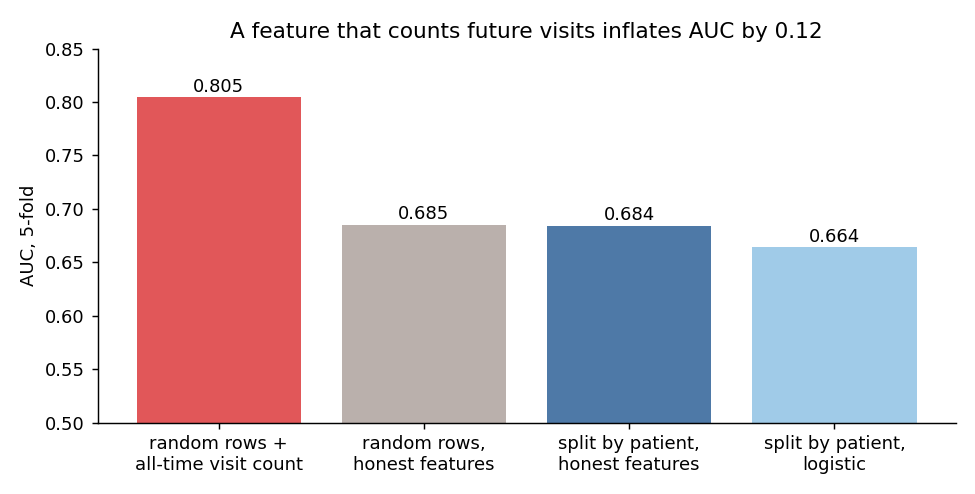
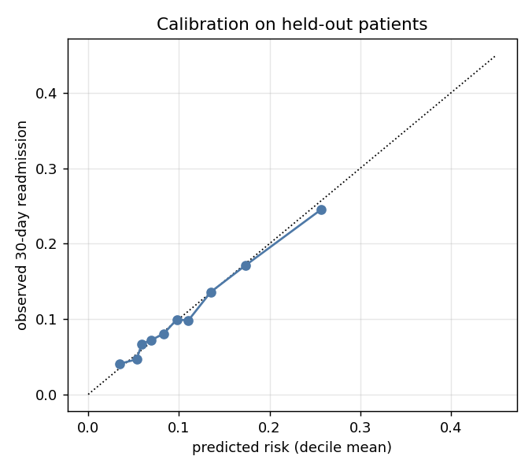
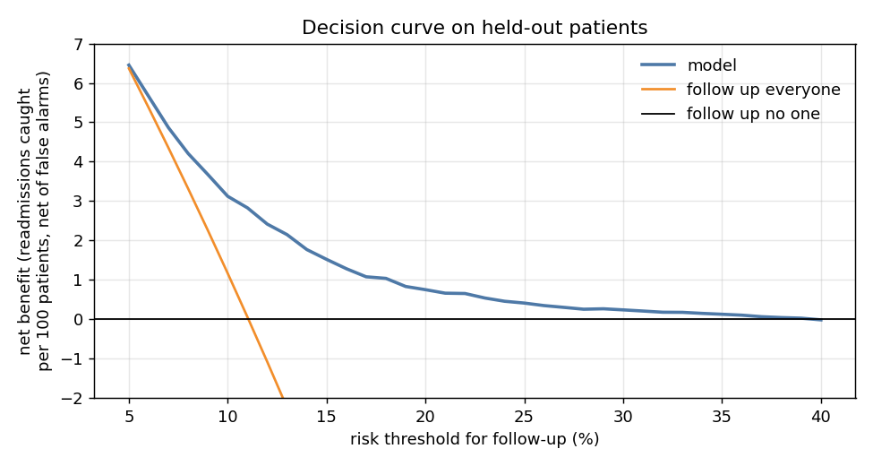
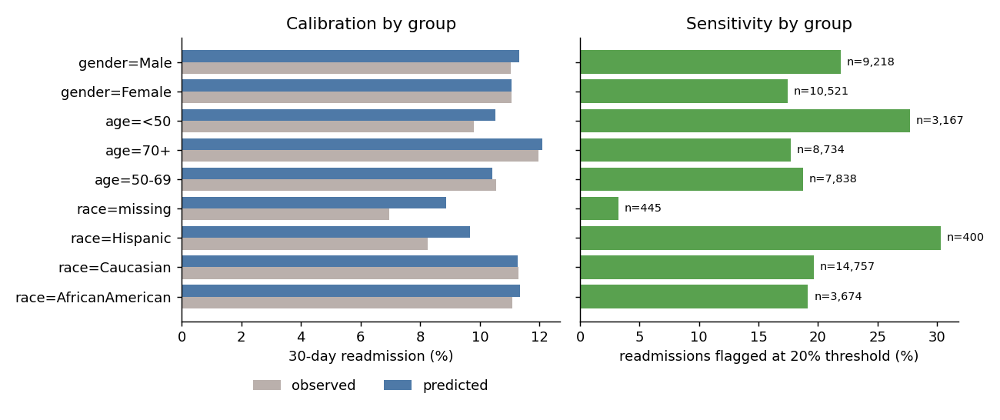

[English](README.md) | **Español**

# Reingreso hospitalario a 30 días: un modelo de riesgo que un hospital podría usar


99.340 hospitalizaciones reales de pacientes diabéticos en 130 hospitales de EE.UU. (1999-2008),
con datos demográficos, diagnósticos, exámenes, medicamentos y visitas previas. El 11,4% reingresa
dentro de 30 días. Los hospitales quieren saber al momento del alta quién necesita seguimiento.

Un modelo de reingreso es fácil de hacer ver bien y difícil de hacer útil. Este proyecto trata de
lo segundo: quitar las fugas que inflan el resultado y después juzgar el modelo como lo haría un
equipo clínico, por calibración, beneficio neto y desempeño parejo entre grupos de pacientes.

## Resultados en breve

| | |
|---|---|
| AUC con las fugas habituales | 0,805 |
| **AUC honesto, en pacientes no vistos** | **0,671** (regresión logística 0,654) |
| Pacientes marcados con riesgo estimado de 20% o más | 7,8%, de los cuales reingresa el 28% (2,4 veces la tasa base) |
| Reingresos en el 10% más riesgoso | 23% |
| Beneficio neto frente a hacer seguimiento a todos | positivo en todos los umbrales de 5% a 39% |
| Grupos más débiles | mayores de 70 (AUC 0,64) y pacientes sin raza registrada (3% de sus reingresos marcados) |

## 1. Dos fugas, una de ellas grande



**Contar las visitas de un paciente en todo el dataset filtra la respuesta.** Un reingreso a 30
días es otra visita, así que "número de hospitalizaciones del paciente" codifica en parte el
objetivo: los pacientes vistos una sola vez reingresan 4,3% *por construcción*. Contar solo las
visitas anteriores a la actual (9,0% en primeras visitas) es lo que el hospital sabe al dar el
alta. La variable con fuga sube el AUC de 0,684 a 0,805.

**Cortar por fila en vez de por paciente casi no importa aquí.** 16.773 pacientes tienen más de
una hospitalización, así que un corte aleatorio pone a la misma persona en entrenamiento y prueba,
pero el AUC solo pasa de 0,684 a 0,685. Se reportan ambos cortes; todo lo que sigue deja fuera
pacientes completos.

Dos decisiones de limpieza salen de la pregunta: se eliminan las hospitalizaciones que terminaron
en fallecimiento o cuidados paliativos (2.423), porque esos pacientes no pueden reingresar, y los
diagnósticos se agrupan por capítulo de la CIE-9 como en Strack et al. (2014).

## 2. Calibrado y útil en umbrales realistas

El 20% de los pacientes (13.998 personas, 19.739 hospitalizaciones) queda fuera por completo.
LightGBM se entrena con el resto; la recalibración isotónica sobre predicciones fuera de la
muestra resultó innecesaria (Brier 0,0939 sin calibrar, 0,0940 calibrado, frente a 0,0983 de
predecir la tasa base para todos).





Una curva de decisión (Vickers y Elkin, 2006) responde si actuar según el modelo supera a las
políticas simples, sin inventar costos: el umbral mismo expresa cuántas falsas alarmas vale un
reingreso detectado. Con umbral de 10%, el modelo da un beneficio neto de 3,1 reingresos detectados
por cada 100 pacientes, frente a 1,2 de hacer seguimiento a todos; sobre 11%, hacer seguimiento a
todos es peor que no hacer nada, mientras el modelo sigue siendo positivo hasta 39%.

Las variables más informativas son las hospitalizaciones previas, el destino al alta, la
especialidad que hospitalizó, las visitas previas y el diagnóstico principal.

## 3. ¿Funciona igual para todos?



Con umbral de 20%, en pacientes no vistos:

- **La calibración se sostiene en los grupos grandes.** Las tasas predichas y observadas coinciden
  dentro de 0,3 puntos para hombres, mujeres, mayores de 50, y pacientes afroamericanos y caucásicos,
  y dentro de 0,8 puntos en menores de 50.
- **Raza: sin brecha entre los dos grupos principales.** Se marca el 19% de los reingresos de
  pacientes afroamericanos y el 20% de los caucásicos.
- **Edad: a los mayores se les sirve peor.** AUC 0,64 en mayores de 70 frente a 0,72 en menores de
  50, y 18% de reingresos marcados frente a 28%. Los pacientes con la tasa de reingreso más alta son
  los que el modelo distingue peor.
- **La raza faltante es un punto ciego real.** En las 445 hospitalizaciones sin raza registrada el
  modelo sobreestima (8,9% predicho, 7,0% observado) y marca el 3% de sus reingresos. La falta de
  datos demográficos suele indicar registros incompletos también en otras variables.
- Los pacientes hispanos (n = 400) tienen sensibilidad alta (30%) pero también se sobreestiman; con
  33 reingresos en el grupo, las cifras son ruidosas.

## Método

```
diabetic_data.csv ──► sin fallecidos ni paliativos · capítulos CIE-9 · solo visitas previas (data.py)
     │
     ├── estudio de fugas: filas al azar + conteo total | filas al azar | por paciente (5 folds)
     │
     ├── 20% de pacientes fuera
     │      LightGBM ── revisión isotónica con predicciones fuera de la muestra
     │      regresión logística como referencia
     │
     └── evaluación en pacientes no vistos: AUC, Brier, calibración, curva de decisión,
                                             calibración, AUC, sensibilidad y VPP por grupo
```

## Datos

Diabetes 130-US hospitals for years 1999-2008, Strack et al. (2014),
"Impact of HbA1c Measurement on Hospital Readmission Rates", *BioMed Research International*;
publicado originalmente en el UCI Machine Learning Repository. Copia en Kaggle
[brandao/diabetes](https://www.kaggle.com/datasets/brandao/diabetes), licencia CC0.
Descargado en octubre de 2026; no se redistribuye aquí.

## Reproducir

```powershell
python -m venv venv
.\venv\Scripts\python.exe -m pip install -r requirements.txt
$env:PYTHONPATH = "src"
python -m readmit.data      # descarga con ~/.kaggle/kaggle.json
python -m readmit.model     # ~3 min
python -m readmit.figures
pytest -q tests
```

## Limitaciones

- Los datos terminan en 2008 y la codificación cambió (CIE-10 en EE.UU. desde 2015). El flujo de
  trabajo se transfiere; el modelo ajustado no.
- No se registran reingresos en otros hospitales, así que el objetivo está subcontado.
- El beneficio neto dice que el modelo supera a las políticas simples para un trade-off dado; si el
  seguimiento realmente evita reingresos es una pregunta causal distinta que estos datos no responden.

## Licencia

Código: MIT. Datos: CC0 (copia en Kaggle del dataset de UCI), no se redistribuyen.
